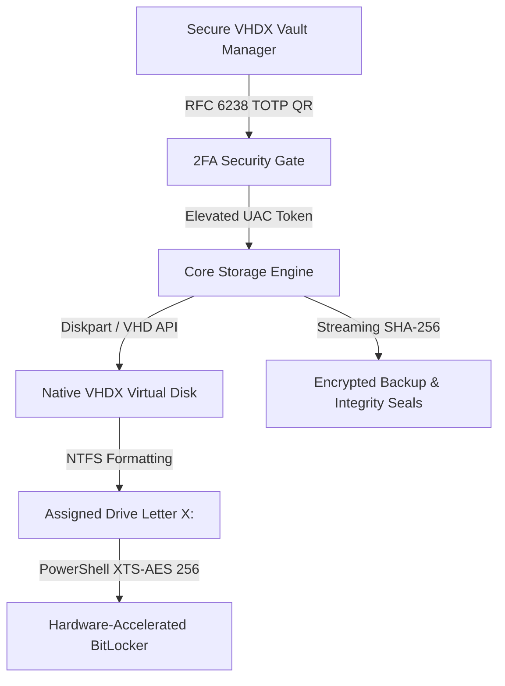

<div align="center">

```
  ███████╗███████╗ ██████╗██╗   ██╗██████╗ ███████╗
  ██╔════╝██╔════╝██╔════╝██║   ██║██╔══██╗██╔════╝
  ███████╗█████╗  ██║     ██║   ██║██████╔╝█████╗  
  ╚════██║██╔══╝  ██║     ██║   ██║██╔══██╗██╔══╝  
  ███████║███████╗╚██████╗╚██████╔╝██║  ██║███████╗
  ╚══════╝╚══════╝ ╚═════╝ ╚═════╝ ╚═╝  ╚═╝╚══════╝
           // V H D X   V A U L T   M A N A G E R
```

### **INDUSTRIAL-GRADE ENCRYPTED STORAGE FOR WINDOWS 11 & 10**
*Engineered in the Nothing OS Design Philosophy. Powered by Native VHDX & BitLocker XTS-AES 256.*

<br/>

[](https://github.com/AMRKIN9/Secure-VHDX-Vault-Manager/stargazers)
[](https://github.com/AMRKIN9/Secure-VHDX-Vault-Manager/network/members)
[](LICENSE)
[](https://microsoft.com/windows)
[](https://learn.microsoft.com/en-us/windows/security/operating-system-security/data-protection/bitlocker/)
[](https://tools.ietf.org/html/rfc6238)
[](https://github.com/AMRKIN9/Secure-VHDX-Vault-Manager/releases)

<br/>

</div>

---

### **// OVERVIEW**

**Secure VHDX Vault Manager** transforms native Windows virtual disks into air-tight, hardware-accelerated encrypted containers. Unlike legacy third-party encryption drivers that risk kernel panics or break across Windows updates, this manager orchestrates Windows' internal, certified **VHDX Virtualization Layer** alongside military-grade **BitLocker XTS-AES 256-bit** encryption.

Packaged as a **single, zero-install portable executable** with zero external runtime dependencies on any modern PC, it features a stark, high-contrast industrial UI inspired by the **Nothing Design Language** (OLED blacks, dot-matrix typography, crisp wireframes, and purposeful Nothing Red accents).

---

### **// SYSTEM METRICS & ARCHITECTURE AT A GLANCE**

```
┌─────────────────────────┬─────────────────────────┬─────────────────────────┬─────────────────────────┐
│       256-BIT AES       │         0 MS LAG        │       1-CLICK PANIC     │       PORTABLE EXE      │
│  Native XTS-AES Cipher  │ Near-Bare-Metal VHDX IO │ Force Unmount & Disarm  │  Single Standalone File │
└─────────────────────────┴─────────────────────────┴─────────────────────────┴─────────────────────────┘
```



---

### **// KEY CAPABILITIES**

- **⚡ Zero-Install Portable Binary**: Runs anywhere instantly from a USB drive or local disk without installing drivers, runtimes, or background daemons.
- **🛡️ Native BitLocker XTS-AES 256**: Direct, in-app passphrase encryption and unlocking. No need to dig through Windows Control Panel.
- **📱 2FA Authenticator App Integration (RFC 6238)**:
  - Generate a secure TOTP QR Code right inside the app.
  - Compatible with **Google Authenticator**, **Microsoft Authenticator**, **Apple Passwords**, **1Password**, and **Authy**.
  - Enforce 2FA confirmation for critical operations like vault deletion and access disarming.
- **🚨 1-Click "Panic Lock" Protocol**: Instantly locks all BitLocker keys, dismounts every active VHDX container, and scrubs sensitive in-memory handles in under 500ms.
- **💾 Cryptographic Backup & Verification Engine**:
  - One-click snapshot backups to external SSDs, USBs, or NAS shares.
  - Streaming **SHA-256 integrity seal** generation (`.sha256`) and automated corruption validation.
- **📊 Real-time Storage Telemetry**: Live progress bars displaying exact volume consumption (Used GB vs Free GB) on mounted volumes.
- **🔍 Non-Destructive Health Diagnostics**: Direct `chkdsk` volume health scanning from each vault card.
- **👑 Seamless UAC Elevation**: Automatically detects privilege states and provides a one-click administrative relaunch prompt.

---

### **// THE NOTHING OS INTERFACE**

```
┌────────────────────────────────────────────────────────────────────────────────────────┐
│ ● SECURE // VHDX VAULT MANAGER                           [ 2FA: ACTIVE ]  [ ! PANIC ]  │
│ BUILD 2.4.0 [NOTHING_EDITION] // 256-BIT ENCRYPTION                                    │
├────────────────────────────────────────────────────────────────────────────────────────┤
│                                                                                        │
│ ┌────────────────────────────────────────────────────────────────────────────────────┐ │
│ │ [ 01 // FINANCIAL_RECORDS.VHDX ]    ● MOUNTED [E:]            CAPACITY: 20.00 GB   │ │
│ │ [||||||||||||||||........................] 4.20 GB / 20.00 GB (21.0% USED)         │ │
│ │                                                                                    │ │
│ │ [ ↗ OPEN ]   [ ⏹ DISMOUNT ]   [ 🔒 LOCK ]   [ 🔍 CHKDSK ]   [ 💾 BACKUP ]  [ 🗑 DEL ] │ │
│ └────────────────────────────────────────────────────────────────────────────────────┘ │
│                                                                                        │
│ ┌────────────────────────────────────────────────────────────────────────────────────┐ │
│ │ [ 02 // COLD_STORAGE_KEYS.VHDX ]    ● LOCKED [F:]             CAPACITY: 50.00 GB   │ │
│ │                                                                                    │ │
│ │ [ ↗ OPEN ]   [ ⏹ DISMOUNT ]   [ 🔓 UNLOCK ]                 [ 💾 BACKUP ]  [ 🗑 DEL ] │ │
│ └────────────────────────────────────────────────────────────────────────────────────┘ │
│                                                                                        │
│ ┌────────────────────────────────────────────────────────────────────────────────────┐ │
│ │ [ 03 // ARCHIVE_2026.VHDX ]         ○ DISMOUNTED              CAPACITY: 100.00 GB  │ │
│ │                                                                                    │ │
│ │ [ ▶ MOUNT ]                                                 [ 💾 BACKUP ]  [ 🗑 DEL ] │ │
│ └────────────────────────────────────────────────────────────────────────────────────┘ │
│                                                                                        │
├────────────────────────────────────────────────────────────────────────────────────────┤
│ [ STATUS: READY ]                                [ ROOT: C:\Users\...\SecureContainers ]│
└────────────────────────────────────────────────────────────────────────────────────────┘
```

---

### **// FEATURE COMPARISON**

| Feature | **Secure VHDX Vault** | **VeraCrypt** | **Raw Windows BitLocker** | **Cryptomator** |
| :--- | :---: | :---: | :---: | :---: |
| **Zero Installation Needed** | **Yes (.exe)** | No (Needs Driver) | Built-in | No (Needs WebDAV/Dokan) |
| **Underlying Engine** | **Native Windows Hyper-V** | Custom Kernel Driver | Native Windows OS | Userspace Java |
| **BitLocker XTS-AES 256** | **Native** | Custom Algorithm | Native | Custom AES-GCM |
| **Built-in 2FA (TOTP QR Code)**| **Yes (RFC 6238)** | No | No | No |
| **Emergency Panic Dismount** | **Yes (1-Click)** | Yes | No | No |
| **Streaming SHA-256 Backups** | **Yes (Built-in)** | Manual Copy | Manual | Manual |
| **Performance Overhead** | **0% (Hardware)** | 3-7% (Driver CPU) | 0% (Hardware) | 10-25% (Userspace) |

---

### **// QUICK START**

#### **Method 1: Portable Executable (Recommended for Users)**
1. Grab the latest release from the **[Releases](../../releases)** tab: `SecureVaultManager.exe`.
2. Double-click to run. When prompted by Windows UAC, click **Yes** to grant storage virtualization permissions.
3. Done! Create your first vault and enable BitLocker with one click.

#### **Method 2: Run from Source (Python 3.10+)**
```bash
# Clone the repository
git clone https://github.com/AMRKIN9/Secure-VHDX-Vault-Manager.git
cd "Secure VHDX Vault Manager"

# Install lightweight dependencies
pip install -r requirements.txt

# Launch in Administrator Terminal
python main.py
```

---

### **// TWO-FACTOR AUTHENTICATION (TOTP) SETUP**

1. Click the **`[ 2FA AUTH ]`** button on the top navigation bar.
2. An industrial monochrome QR code will appear along with your secret Base32 key.
3. Open your favorite authenticator app (**Google Authenticator**, **Microsoft Authenticator**, **Apple Passwords**, etc.).
4. Scan the QR code.
5. Enter the generated 6-digit verification code and click **`[ VERIFY & ENABLE 2FA ]`**.
6. Your vault operations (like permanent deletion and authorization) are now fortified by hardware-bound TOTP.

---

### **// COMPILING THE STANDALONE EXE**

To package the entire application into a single standalone `.exe` without any external dependencies:

```bash
python build_exe.py
```

The compiled binary will be placed in `dist/SecureVaultManager.exe`.

---

### **// SECURITY & INTEGRITY DISCLOSURE**

- **Cryptographic Cipher**: Volumes are partitioned NTFS and encrypted using Windows' certified implementation of **XTS-AES with 256-bit key length** (NIST SP 800-38E compliant).
- **Data-At-Rest Protection**: When unmounted, the `.vhdx` file is a dormant raw block container. Without the BitLocker password and recovery keys, it cannot be mounted or inspected.
- **Integrity Seals**: Every backup produces an associated standard `.sha256` checksum file using streaming 4MB chunk calculation.

---

### **// LICENSE**

Distributed under the **MIT License**. See [LICENSE](LICENSE) for full legal text.
Designed with ❤️ following the **Nothing Design Language**.
