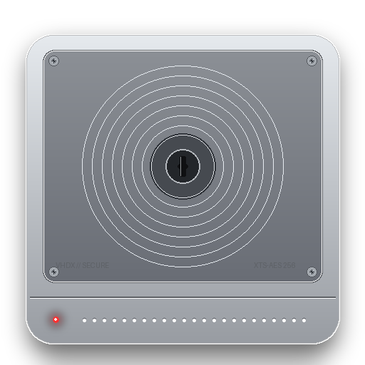

<div align="center">



# Secure VHDX Vault Manager

**Create private, encrypted personal drives on Windows in seconds — powered by native BitLocker (AES-256), VHDX virtualization, and 2FA.**

[](LICENSE)
[](https://microsoft.com/windows)
[](https://learn.microsoft.com/en-us/windows/security/operating-system-security/data-protection/bitlocker/)
[](https://tools.ietf.org/html/rfc6238)
[](https://github.com/AMRKIN9/Secure-VHDX-Vault-Manager/releases)

</div>

---

### What is this?

Ever wanted an encrypted digital safe for your private files without installing bloated third-party kernel drivers or trusting proprietary cloud tools?

**Secure VHDX Vault Manager** lets you create isolated, password-protected virtual disk drives (`.vhdx`) formatted with Windows' own enterprise-grade **BitLocker XTS-AES 256-bit encryption**. 

Mount your vault with one click, work inside it like a normal USB or hard drive (e.g. drive `E:`), and dismount or lock it when you're done. When closed, your vault is just a single unreadable `.vhdx` file that cannot be opened without your password.

---

### Why use this over VeraCrypt or Cloud Lockers?

- **Zero Installation Required**: Runs as a single portable `.exe` file. No drivers, no background services, no reboot required.
- **Native Windows Speed**: Uses Windows' built-in Hyper-V VHDX storage engine. Zero CPU overhead compared to third-party file drivers.
- **Direct BitLocker Setup**: Set your encryption password directly in the app. No need to touch Windows Control Panel or PowerShell.
- **Two-Factor Authentication (2FA)**: Scan an in-app QR code with Google Authenticator, Microsoft Authenticator, or Apple Passwords to guard sensitive operations.
- **One-Click Panic Lock**: Emergency red button instantly locks BitLocker and dismounts all active vaults in under a second.
- **Automated Checksum Backups**: Create timestamped snapshot backups with streaming SHA-256 integrity verification to protect against disk corruption.

---

### Key Features

| Feature | Description |
| :--- | :--- |
| **Instant Vault Creation** | Create dynamic (expandable) or fixed-size VHDX containers from 1 GB to multi-terabyte drives. |
| **Hardware Encryption** | Protected by Microsoft BitLocker XTS-AES 256-bit encryption. |
| **2FA Authenticator** | Built-in RFC 6238 TOTP engine with QR code generation for your mobile authenticator app. |
| **Live Storage Meter** | Displays real-time disk consumption (used GB vs free GB) on mounted vaults. |
| **Panic Dismount** | One-click button to immediately force-dismount and lock all volumes. |
| **Integrity Checks** | Run non-destructive `chkdsk` volume health scans directly from the vault card. |
| **UAC Auto-Elevation** | Automatically detects administrator privilege needs with a single-click prompt. |

---

### How It Works

1. **Create a Vault**: Choose a name, capacity (e.g., 20 GB), and optional BitLocker password.
2. **Mount & Use**: Click **Mount** to attach the vault as a regular Windows drive letter (e.g. `E:`). Drag and drop your files into it.
3. **Lock & Dismount**: Click **Dismount** or **Lock**. The drive vanishes from File Explorer and returns to an encrypted, locked file.

---

### Getting Started

#### Option A: Download the Portable App (Zero Install)
1. Download **`SecureVaultManager.exe`** from the [Releases](https://github.com/AMRKIN9/Secure-VHDX-Vault-Manager/releases) tab.
2. Double-click to run. When Windows prompts for Administrator access, click **Yes** (required for mounting virtual disks).
3. Start creating your encrypted vaults.

#### Option B: Run from Source
```bash
# Clone the repository
git clone https://github.com/AMRKIN9/Secure-VHDX-Vault-Manager.git
cd "Secure-VHDX-Vault-Manager"

# Install lightweight requirements
pip install -r requirements.txt

# Run the app (requires Admin terminal)
python main.py
```

---

### 2FA Authenticator Setup

1. Click **`[ 2FA AUTH ]`** on the top toolbar.
2. Scan the displayed QR code with your authenticator app (**Google Authenticator**, **Microsoft Authenticator**, **Apple Passwords**, **Authy**, etc.).
3. Enter the 6-digit verification code to activate.
4. Once enabled, destructive actions like vault deletion require your 6-digit code.

---

### Building the Standalone `.exe`

To package everything into a single self-contained executable:

```bash
python build_exe.py
```

The resulting file will be saved in `dist/SecureVaultManager.exe`.

---

### License

This project is licensed under the [MIT License](LICENSE).
